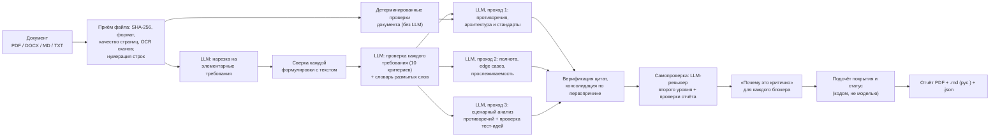

# req-review-agent — ИИ-агент статической проверки требований

Агент читает документ требований (PDF, DOCX, Markdown, TXT), выделяет из него отдельные требования,
проверяет **каждое требование** и **весь набор целиком** по критериям
**ISO/IEC/IEEE 29148:2018 (п. 5.2.5, 5.2.6)** и **IEEE Std 830-1998 (п. 4.3)** и записывает отчёт на русском языке.

Решение для кейса [BCC-HUB x MNU FinTech Hackathon](https://github.com/BCC-HUB/ai-requirements-validator-task).

**Модель:** Google Gemini **`gemini-3.8-flash`** (бесплатный тариф Google AI Studio).
Можно указать другую модель Gemini или подключить OpenAI-совместимый API / локальную Ollama (см. `.env.example`).

---

## Быстрый старт (если Python уже установлен)

```bash
git clone https://github.com/gooflamingo75/req-review-agent.git
cd req-review-agent
pip install -r requirements.txt
cp .env.example .env          # Windows: copy .env.example .env
# откройте .env и вставьте ключ в GEMINI_API_KEY=
python review.py docs/requirements.md reports/report.md
```

Появятся три файла: **`reports/report.pdf`** (основной отчёт для чтения), `reports/report.md` (тот же отчёт в
Markdown) и `reports/report.json` (данные для программ). Вместо `.md` можно указать `.pdf` — результат тот же.

---

## Подробная инструкция для новичка

### Шаг 1. Установить Python (один раз)

**Windows**
1. Откройте https://www.python.org/downloads/ и нажмите жёлтую кнопку **Download Python 3.x**.
2. Запустите скачанный файл. **Обязательно поставьте галочку «Add python.exe to PATH»** внизу окна, затем **Install Now**.
3. Откройте **Командную строку**: нажмите `Win`, наберите `cmd`, нажмите `Enter`.
4. Проверьте: `python --version` — должно показать `Python 3.10` или новее.

**macOS**
1. Откройте https://www.python.org/downloads/ и скачайте **Python 3.x** для macOS, установите как обычную программу.
2. Откройте **Терминал**: `Cmd + Пробел`, наберите `Terminal`, `Enter`.
3. Проверьте: `python3 --version`.

> На macOS везде ниже пишите `python3` и `pip3` вместо `python` и `pip`.

### Шаг 2. Скачать код агента

Вариант А (без Git): на странице репозитория нажмите зелёную кнопку **Code → Download ZIP**, распакуйте архив
(например, на Рабочий стол).

Вариант Б (с Git): `git clone https://github.com/gooflamingo75/req-review-agent.git`

Перейдите в папку с агентом в командной строке/терминале. Проще всего: напишите `cd ` (с пробелом)
и перетащите папку мышкой в окно, затем `Enter`.

### Шаг 3. Установить зависимости (один раз)

```bash
pip install -r requirements.txt
```
(macOS: `pip3 install -r requirements.txt`)

### Шаг 4. Получить бесплатный ключ Gemini

1. Откройте https://aistudio.google.com/apikey и войдите в Google-аккаунт.
2. Нажмите **Create API key** и скопируйте ключ (длинная строка, начинается с `AIza…`).

### Шаг 5. Положить ключ в файл `.env`

1. В папке агента сделайте копию файла `.env.example` и назовите её **`.env`**:
   - Windows: `copy .env.example .env`
   - macOS: `cp .env.example .env`
2. Откройте `.env` любым текстовым редактором (Блокнот / TextEdit):
   - Windows: `notepad .env`
   - macOS: `open -e .env`
3. Замените `your_gemini_api_key_here` на свой ключ, чтобы строка выглядела так:
   ```
   GEMINI_API_KEY=AIzaSy...ваш_ключ...
   ```
4. Сохраните файл.

> 🔒 Файл `.env` указан в `.gitignore` и **не попадает в репозиторий**. Никому не отправляйте ключ.

### Шаг 6. Положить документ и запустить проверку

1. Создайте в папке агента папку `docs` и положите туда документ организаторов `requirements.md`
   (скачать: https://github.com/BCC-HUB/ai-requirements-validator-task/blob/main/docs/requirements.md → кнопка «Download raw file»).
   Подойдёт и любой другой путь, и формат PDF/DOCX/TXT.
2. Запустите **одной командой**:

```bash
python review.py docs/requirements.md reports/report.md
```

Формат команды: `python review.py <путь к файлу требований> <путь к файлу отчёта>`.

Прогон занимает 8–15 минут: агент делает паузы между запросами, чтобы уложиться в лимиты бесплатного тарифа.
В конце будет написано, где лежит отчёт:

```
Готово! Статус проверки: Завершена
  Отчёт (PDF): .../reports/report.pdf
  Отчёт (Markdown): .../reports/report.md
  Данные (JSON): .../reports/report.json
  Требований: 25, дефектов: 40 (критичных: 8)
```

### Шаг 7. Открыть отчёт

Откройте **`reports/report.pdf`** двойным щелчком. На первой странице — **панель**: статус проверки, что именно
прочитано и проверено, инциденты чтения файла, число дефектов и вывод о готовности. Ссылки «строка 104» в отчёте
кликабельны и ведут в приложение «Исходный текст», где показан весь документ с номерами строк. Слева в
PDF-просмотрщике есть закладки по разделам.

**Статус проверки** в панели:

| Статус | Что значит |
|---|---|
| ✅ Завершена | весь документ прочитан, все этапы проверки выполнены |
| ⚠️ Частичная | что-то не удалось прочитать или проверить (это перечислено в панели); вердикт относится только к проверенной части |
| ⛔ Не выполнена | документ пустой, повреждён, защищён паролем или модель недоступна — создаётся диагностический отчёт с причиной и тем, что сделать |
| ℹ️ Нет оцениваемых требований | файл прочитан, но требований в нём нет |

---

## Проверка установки без ключа (демо-режим)

```bash
python review.py examples/sample_requirements.md reports/demo.md --mock
```

Демо-режим не обращается к модели и использует только встроенные правила — он нужен, чтобы убедиться,
что всё установлено. **Для сдачи нужен обычный прогон с моделью.**

**Перестроить отчёт без нового прогона модели** (например, после обновления оформления):

```bash
python review.py docs/requirements.md reports/report-new.pdf --from-json reports/report.json
```

Автотесты (тоже без ключа): `python tests/test_pipeline.py` и `python tests/test_ingest.py`
(второй проверяет пустые, повреждённые, зашифрованные, отсканированные и смешанные файлы, частичную проверку и PDF).

---

## Сканы и OCR (необязательно)

Обычные PDF, DOCX, MD и TXT читаются без OCR. OCR нужен, только если документ — **скан** или требования есть
на **картинках**. Агент сам проверяет каждую страницу: если на ней нет текстового слоя, текст искажён или
страница — изображение, он вызывает OCR. Если OCR не установлен, агент **не делает вид, что всё прочитал**:
страница помечается как непрочитанная, статус проверки становится «Частичная», а в панели написано, что сделать.

Установка (один раз):

- **macOS:** `brew install tesseract tesseract-lang`, затем `python3 -m pip install -r requirements-ocr.txt`
- **Windows:** установите Tesseract (сборка UB Mannheim: https://github.com/UB-Mannheim/tesseract/wiki), в
  установщике отметьте язык **Russian**; затем `python -m pip install -r requirements-ocr.txt`. Если программа
  не находится, впишите в `.env` путь: `TESSERACT_CMD=C:\Program Files\Tesseract-OCR\tesseract.exe`

Проверка установки: `python ocr_worker.py --check` — должно появиться `"ok": true`. Проверка распознаёт
контрольную картинку с русским текстом и цифрами, а не только смотрит, что программа есть.

Что сознательно не сделано: агент **не устанавливает** OCR сам во время проверки (установка системных программ
по ходу работы небезопасна и непредсказуема) и не отправляет документы во внешние OCR-сервисы. Docker-образ и
lock-файл с хешами пакетов не поставляются: версии, на которых проверена работа, указаны в `requirements-ocr.txt`.

Что OCR умеет и не умеет: он распознаёт то, что **видно** на странице. Он не восстановит вырезанные страницы,
обрезанный файл или документ под паролем. Строки, распознанные OCR, помечены в отчёте; критичный вывод, который
держится только на неуверенно распознанной строке, понижается до MAJOR с пометкой «сверьте с оригиналом».

---

## Как работает агент

**Версия 3.0** добавила: приём файла с проверкой целостности (SHA-256, размер, фактический формат, пустые,
повреждённые и зашифрованные файлы), контроль качества каждой страницы и OCR, честный подсчёт покрытия,
открывающую панель со статусом проверки, блок «Почему это критично» для каждого блокера и автоматический
PDF-отчёт с кликабельными ссылками на строки исходного текста.

**Версия 3.2** (по итогам аудита отчёта):
- *обязательная матрица сценариев:* для каждой пары нормативных правил и каждого критерия приёмки модель обязана
  дать вердикт («нет конфликта» / «конфликт» / «приоритет не определён»), а тест-идеи с неявными допущениями
  («при условии…», «предполагая…») проверяются отдельно — противоречие нельзя «спрятать» в тест-идее;
- *новые универсальные правила без LLM:* одно и то же поле с разными типами в разных таблицах параметров
  (например, integer в запросе и string в ответе); ограничение по времени без перцентиля, нагрузки и точек
  начала/окончания измерения;
- *строже самопроверка:* снять дефект можно только цитатой из ДРУГОГО места документа; технические утверждения
  (флаги CLI, семантика HTTP, арифметика дат и поясов) проверяются; рекомендации, ослабляющие безопасность,
  переписываются; пограничные сценарии и вопросы, на которые документ уже отвечает, убираются;
- *ссылки и цитаты:* каждая ссылка [Lnn] в тексте дефекта проверяется — указывает на непустую строку с
  цитируемым текстом, иначе исправляется или удаляется; искажённые цитаты заменяются дословными; цитаты не обрезаются;
- *без повторов:* дефект требования, совпадающий с дефектом набора по строке, сливается с ним; противоречия
  разных пар не склеиваются; «оформительские» дефекты из разных разделов не склеиваются; вопросы без дублей;
- *согласованные отметки:* требование, затронутое системным дефектом или открытым пограничным сценарием,
  не может иметь ✓ по соответствующему критерию;
- *стабильные номера:* в журнале отклонённых кандидатов номера D-xx, ссылки на итоговые номера дефектов;
- *модель:* каждый запрос сначала идёт к основной модели; доля запросов по моделям видна в паспорте, а если
  основная модель обработала меньше половины — в резюме есть предупреждение.



1. **Приём и чтение.** Агент делает снимок файла, считает SHA-256 и размер, определяет фактический формат по
   содержимому (переименованная картинка не выдаётся за PDF), проверяет пустой файл, повреждения и пароль.
   Каждая страница PDF проверяется: есть ли текстовый слой, не искажён ли текст, не скан ли это; при
   необходимости вызывается OCR в отдельном процессе с ограничением времени. Ссылки на приложения, которых нет
   в файле, отмечаются как подозрение на неполный комплект. Всё это — инциденты `ING-…`, отдельно от дефектов.
   Затем фиксируется **канонический транскрипт**: пронумерованные строки (для PDF — страница и строка L…),
   разделы и части документа. На него ссылаются все цитаты, счётчики и приложение «Исходный текст».
2. **Нарезка.** Модель выделяет элементарные требования — в т. ч. из таблиц параметров API, кодов ответов,
   критериев приёмки и требований без слова «должен». Каждая формулировка сверяется с текстом документа;
   выдуманные отбрасываются. Требования получают ID `REQ-01…`, исходный ID документа сохраняется.
3. **Проверка каждого требования** — по 10 критериям: 6 основных из руководства организаторов (полнота,
   однозначность, непротиворечивость, тестируемость, реализуемость, необходимость) и 4 дополнительных из
   ISO/IEC/IEEE 29148 (без лишних проектных решений, атомарность, корректность, соответствие форме).
   Для каждого требования модель видит весь документ, даёт комментарий по каждому критерию, дефекты с
   цитатой, рекомендацию, **идеи тест-кейсов и граничные значения** и **вопросы к аналитику**.
   Словарь размытых формулировок («быстро», «удобно», «и т.д.», «по возможности», TBD…) дополняет модель.
4. **Проверка набора** — три отдельных прохода модели:
   - *непротиворечивость, архитектура и стандарты:* попарное сравнение правил, критерии приёмки vs правила,
     основная часть vs дочерняя спецификация API, единицы и типы данных, HTTP-методы и коды ответов (RFC 9110),
     безопасность, идемпотентность;
   - *полнота, пограничные сценарии, прослеживаемость:* пробелы и заглушки, негативные сценарии,
     **таблица непокрытых edge cases**, **матрица прослеживаемости** Бизнес-цель → UI/UX → Требование →
     API/Данные → Критерии приёмки;
   - *сценарный анализ противоречий:* модель группирует правила по объекту (лимиты, частоты, триггеры,
     исключения, сбросы), для каждой пары проигрывает конкретный сценарий с числами и датами и сравнивает
     результаты; затем проверяет каждый критерий приёмки и **собственные идеи тест-кейсов** против всех правил.
     Найденное противоречие переопределяет оценку «Непротиворечивость» у обоих требований.
5. **Детерминированные проверки документа (без LLM)** — универсальные правила, применимые к любой
   спецификации: смешение основной и дробной денежной единицы без правила конвертации; HTTP GET для операции,
   изменяющей состояние; пример ошибки в разделе успешного ответа 200; заглушки шаблона («заполняются …»,
   «—», «Да / Нет» без отметки, пустые таблицы, незаполненная версия); Content-Type при отсутствии тела;
   одно поле с разными типами в разных таблицах параметров; срок без перцентиля и точки измерения.
   Их результаты передаются модели как подсказки и добавляются в отчёт, если модель их не нашла
   (помечены «автоматическая проверка»).
6. **Консолидация по первопричине.** Один дефект, найденный в нескольких местах (например, GET для операции
   сохранения в описании метода, в curl-примере и в логике), становится ОДНИМ дефектом со списком всех мест;
   дословные дубли удаляются. Счётчики и Action Items считаются по уникальным дефектам, число мест — отдельно
   («3 блокера в 11 местах»). У каждого требования указаны затрагивающие его системные дефекты.
7. **Верификация.** Каждая цитата ищется в документе (без учёта регистра, пробелов и вида кавычек; с нечётким
   поиском рядом с требованием). Замечания без подтверждения отбрасываются, всё это фиксируется в журнале отчёта.
8. **Самопроверка отчёта (v2.2).** Агент проверяет сам себя, прежде чем выдать отчёт:
   - *LLM-ревьюер второго уровня* перечитывает все найденные дефекты вместе с документом и ищет ложные
     срабатывания (дефект «опровергается» текстом документа), завышенную критичность (стиль и оформление —
     не выше MINOR) и неверный критерий. Снять дефект можно только с **дословной цитатой-доказательством**
     из документа — иначе дефект остаётся. Все снятые дефекты видны в приложении «Отклонено при самопроверке»;
   - *запрет выдуманных значений:* URL, пути и значения, которых нет в документе, заменяются на
     «<указать …>» — агент не придумывает за аналитика;
   - *согласованность отчёта:* у каждого ❌/⚠️ в таблице критериев есть конкретный дефект с местом; найденное
     противоречие отражается у обоих требований; комментарий «согласовано» не может стоять у проваленного критерия;
   - *покрытие критериями приёмки:* правила, у которых нет ни одного критерия приёмки, выносятся отдельным дефектом;
   - *структура документа:* пункт, оказавшийся под заголовком чужого раздела (например, описание кода 404
     внутри раздела 403), определяется автоматически, а место указывается по фактическому разделу.

**Надёжность и скорость работы с LLM (v3.3):** JSON-режим ответа и повторный запрос при невалидном JSON;
при перегрузке (503), тайм-ауте или обрыве запрос без ожидания уходит на следующую модель, а перегруженная
модель пропускается около минуты (пауза растёт при повторах) и затем снова получает запросы первой;
отсутствующие модели (404) и модели с исчерпанным дневным лимитом исключаются до конца прогона; при
поминутном лимите (429) — пауза по `retryDelay`; тайм-аут одного запроса 4 мин. Независимые запросы
(пакеты проверки требований и два прохода проверки набора) выполняются параллельно, результаты собираются
в исходном порядке — отчёт от этого не меняется; если пакет не удалось проверить — применяются правила, а в отчёте есть предупреждение.

### Критерии

| Код | Отдельное требование | Источник |
|---|---|---|
| COM | Полнота | 29148 §5.2.5 d, IEEE 830 §4.3.3, руководство 1.1 |
| UNA | Однозначность | 29148 §5.2.5 c, IEEE 830 §4.3.2, руководство 1.2 |
| CON | Непротиворечивость | IEEE 830 §4.3.4, руководство 1.3 |
| VER | Тестируемость (проверяемость) | 29148 §5.2.5 g, IEEE 830 §4.3.6, руководство 1.4 |
| FEA | Реализуемость | 29148 §5.2.5 f, руководство 1.5 |
| NEC | Необходимость | 29148 §5.2.5 a, руководство 1.6 |
| APP | Без лишних проектных решений | 29148 §5.2.5 b, руководство 1.6 |
| SIN | Атомарность | 29148 §5.2.5 e |
| COR | Корректность | 29148 §5.2.5 h, IEEE 830 §4.3.1 |
| CNF | Соответствие форме и трассируемость | 29148 §5.2.5 i, IEEE 830 §4.3.8 |

| Код | Набор требований | Источник |
|---|---|---|
| S-COMPL | Системная полнота | 29148 §5.2.6 a, IEEE 830 §4.3.3, руководство 2.1 |
| S-CONS | Взаимная непротиворечивость | 29148 §5.2.6 b, IEEE 830 §4.3.4, руководство 2.2 |
| S-FEAS | Архитектурная осуществимость и стандарты | 29148 §5.2.6 c |
| S-COMP | Понятность | 29148 §5.2.6 d |
| S-BND | Ограниченность | 29148 §5.2.6 e |
| S-RANK | Ранжированность | IEEE 830 §4.3.5 |
| S-MOD | Модифицируемость и версионность | IEEE 830 §4.3.7 |
| S-TRC | Прослеживаемость | IEEE 830 §4.3.8, руководство 2.3 |

**Критичность** (по руководству организаторов): 🔴 **CRITICAL** — прямые противоречия, непроверяемость,
грубые нарушения стандартов протоколов, отсутствие обработки критических ошибок (разработку начинать нельзя);
🟡 **MAJOR** — неполнота сценариев, двусмысленность, расхождения форматов и типов, пустые разделы;
🟢 **MINOR** — стиль, версионирование, незаполненный блок согласующих.

### Состав отчёта (по шаблону организаторов)

Отчёт построен «решения — первыми» (как консалтинговый отчёт для руководителя): первые страницы отвечают
на вопрос «что делать», всё остальное — в приложениях. Оформление — в фирменном зелёном BCC (#00ab75).

1. **Страница 1 — вердикт и решения.** Вердикт одной фразой и ключевые цифры; ценность в цифрах (время
   проверки агентом против оценки ручной инспекции: ≈1 стр. в час по Gilb & Graham, «Software Inspection»);
   при `--compare` — «было → стало». Затем **решения до старта разработки**: блокеры с общей первопричиной
   сведены в одно решение, у каждого — вопрос, варианты (А/Б/В — значения берутся из документа), одна строка
   влияния на бизнес и кто решает (владелец продукта, аналитик, владелец API, QA-лид).
2. **Страницы 2–3 — план исправлений по ролям** (аналитик / владелец API / QA): остальные дефекты без повторов,
   сведённые к действиям; мелкие правки — одной строкой со ссылками.
3. **Страница 4 — вопросы к аналитику и тест-кейсы** — две таблицы без дублей.
4. **Приложения:** А — паспорт прогона и объём проверки (модель, SHA-256, статус, сколько текста проверено);
   Б — нарезка и инвентаризация требований; В — детальная проверка требований (матрица ✅/⚠️/❌ по 10 критериям,
   карточки дефектов с цитатой, местом, рекомендацией и «Почему это критично»); Г — проверка набора (полнота,
   непротиворечивость, осуществимость, прослеживаемость, пограничные сценарии); Д — статистика; Е — полная
   матрица критериев и прослеживаемость; Ж — критерии и методика; при `--compare` — «Что изменилось»;
   З — журнал проверки и отклонённые ложные срабатывания; И — приём документа и покрытие; К — **исходный
   текст** с номерами строк (цель всех ссылок в PDF).

**Цикл «исправили → перепроверили»:** после правок документа запустите агента с `--compare` и прошлым
`.json` — на первой странице появится «было → стало», в приложении — какие дефекты закрыты, какие новые:

```bash
python review.py docs/requirements_v2.md reports/v2.pdf --compare reports/v1.json
```

Рядом с отчётом сохраняется `report.json` — те же данные в машиночитаемом виде (для CI, трекеров задач,
дашбордов), включая статус проверки, журнал приёма документа и манифест покрытия.

**Код завершения команды** (для автоматизации): `0` — проверка завершена; `10` — частичная (отчёт есть,
ограничения в панели); `11` — нет оцениваемых требований; `2` — документ нельзя прочитать (диагностический
отчёт); `3` — модель недоступна (диагностический отчёт); `4` — PDF не создан (Markdown и JSON есть).

### Соответствие требованиям кейса

| Требование кейса | Где выполнено |
|---|---|
| Чтение PDF + других форматов | `reqreview/loader.py`, `reqreview/ingest.py` (PDF, DOCX, Markdown, TXT; сканы — OCR) |
| Отчёт-файл | PDF (основной) + Markdown + JSON, одна модель данных |
| Выделение отдельных требований, свои ID при отсутствии, цитата | шаг 2, раздел 2 отчёта |
| Проверка каждого требования и набора по ISO 29148 / IEEE 830 | шаги 3–4, разделы 3–4 отчёта |
| Каждое нарушение ссылается на конкретное место | строка/страница + раздел + дословная цитата, верификация |
| Паспорт, нарезка, сводка, итог | разделы 1, 2, 5, 6 отчёта |
| Запуск одной командой: путь к требованиям и путь к отчёту | `python review.py <файл> <отчёт>` (или `--input/--output`) |
| README, зависимости, `.env.example` без ключа | этот файл, `requirements.txt`, `.env.example` |

## Настройки (`.env`)

| Переменная | По умолчанию | Назначение |
|---|---|---|
| `LLM_PROVIDER` | `gemini` | `gemini`, `openai` (любой OpenAI-совместимый API) или `ollama` |
| `GEMINI_API_KEY` | — | ключ Google AI Studio |
| `GEMINI_MODEL` | `gemini-3.8-flash` | модель Gemini |
| `GEMINI_FALLBACK_MODELS` | `gemini-3.6-flash,…` | резервные модели: при перегрузке (503) запрос сразу уходит на резервную, основная пропускается ~1 мин; 404 и дневной лимит — модель исключается |
| `REQUEST_INTERVAL_SEC` | `6` | пауза между запросами к одной модели (лимиты бесплатного тарифа) |
| `PARALLEL_REQUESTS` | `4` | сколько независимых запросов выполнять одновременно (1 — по очереди) |
| `BATCH_SIZE` | `8` | требований в одном запросе на проверку |
| `MAX_INPUT_MB` / `MAX_PAGES` | `50` / `200` | лимиты; превышение честно показывается как непроверенная часть |
| `OCR_ENABLED` | `auto` | `auto` — использовать OCR, если установлен; `off` — не использовать |
| `OCR_LANGUAGES` / `OCR_DPI` / `OCR_PAGE_TIMEOUT_SEC` | `rus+eng` / `300` / `60` | параметры OCR |
| `TESSERACT_CMD` | — | путь к программе Tesseract, если она не находится автоматически |
| `PDF_PASSWORD` | — | пароль защищённого PDF (только если он вам законно передан; обход пароля не выполняется) |

Параметры командной строки: `--input/-i`, `--output/-o` (альтернатива позиционным аргументам), `--model <имя>`, `--batch-size <N>`, `--mock`.

## Частые проблемы

| Сообщение | Что делать |
|---|---|
| `python` не найден | Переустановите Python с галочкой «Add to PATH» (Windows) или используйте `python3` (macOS). |
| `No module named ...` | Выполните `pip install -r requirements.txt`. |
| `Не задан GEMINI_API_KEY` | Проверьте, что файл называется именно `.env` (не `.env.txt`) и лежит в папке агента. |
| `Ключ отклонён` | Скопируйте ключ заново из AI Studio, без пробелов и кавычек. |
| `Модель … не найдена` | Укажите в `.env` другую модель из списка в AI Studio (https://aistudio.google.com). |
| Ошибка 503 (перегрузка) | Агент сам повторяет запрос и переключается на резервную модель. Фактически использованная модель указывается в паспорте отчёта. |
| Ошибка 429 / лимит | Агент сам ждёт и повторяет. Если исчерпан дневной лимит — попробуйте позже или другую модель. |
| Статус «Частичная» | Откройте раздел B панели: там написано, что не прочитано или не проверено и что сделать. |
| «OCR недоступен» | Документ — скан или в нём картинки. Установите OCR (раздел «Сканы и OCR») или пришлите PDF с текстом. |
| «PDF не создан» | Markdown и JSON всё равно созданы; пришлите текст ошибки из консоли. |

## Структура репозитория

```
review.py               — точка входа (одна команда)
reqreview/ingest.py     — приём файла: снимок, SHA-256, формат, пустые/повреждённые/зашифрованные, инциденты ING-…
reqreview/loader.py     — чтение PDF/DOCX/MD/TXT, контроль качества страниц, OCR-восстановление, транскрипт, поиск цитат
reqreview/ocr.py        — вызов OCR в отдельном процессе с ограничением времени
ocr_worker.py           — OCR-воркер (Tesseract) и проверка установки: python ocr_worker.py --check
reqreview/coverage.py   — учёт покрытия (символы, фрагменты, обязательные проверки) и статус проверки
reqreview/llm.py        — Gemini / OpenAI-совместимый API / демо-режим, повторы при лимитах
reqreview/prompts.py    — промпты
reqreview/criteria.py   — критерии ISO/IEC/IEEE 29148, IEEE 830 и руководства организаторов; классификация критичности
reqreview/rules.py      — правила без LLM (размытые слова, TBD, технологии, ID, единицы, HTTP, заглушки)
reqreview/agent.py      — конвейер: выделение → проверка требований → проверка набора (3 прохода) → верификация
reqreview/verify.py     — самопроверка: LLM-ревьюер второго уровня, удаление выдуманных URL, согласованность отчёта
reqreview/consolidate.py — объединение дефектов с общей первопричиной, удаление дублей
reqreview/report.py     — отчёт (панель + шаблон организаторов + приложения) в Markdown и JSON
reqreview/pdf.py        — PDF-версия отчёта: шрифты с кириллицей, ссылки на строки, закладки, номера страниц
examples/               — учебный документ с намеренными дефектами (не документ организаторов)
tests/                  — автотесты без ключа (test_pipeline.py, test_ingest.py; фикстуры генерируются в тестах)
requirements-ocr.txt    — необязательные пакеты для OCR
```
