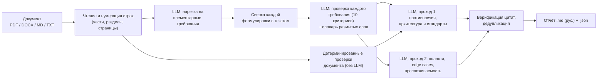

# req-review-agent — ИИ-агент статической проверки требований

Агент читает документ требований (PDF, DOCX, Markdown, TXT), выделяет из него отдельные требования,
проверяет **каждое требование** и **весь набор целиком** по критериям
**ISO/IEC/IEEE 29148:2018 (п. 5.2.5, 5.2.6)** и **IEEE Std 830-1998 (п. 4.3)** и записывает отчёт на русском языке.

Решение для кейса [BCC-HUB x MNU FinTech Hackathon](https://github.com/BCC-HUB/ai-requirements-validator-task).

**Модель:** Google Gemini **`gemini-3.8-flash`** (бесплатный тариф Google AI Studio).
Можно указать другую модель Gemini или подключить OpenAI-совместимый API / локальную Ollama (см. `.env.example`).

---

## Быстрый старт (если Python уже установлен)

```bash
git clone https://github.com/gooflamingo75/req-review-agent.git
cd req-review-agent
pip install -r requirements.txt
cp .env.example .env          # Windows: copy .env.example .env
# откройте .env и вставьте ключ в GEMINI_API_KEY=
python review.py docs/requirements.md reports/report.md
```

Отчёт появится в `reports/report.md` (и машиночитаемая копия `reports/report.json`).

---

## Подробная инструкция для новичка

### Шаг 1. Установить Python (один раз)

**Windows**
1. Откройте https://www.python.org/downloads/ и нажмите жёлтую кнопку **Download Python 3.x**.
2. Запустите скачанный файл. **Обязательно поставьте галочку «Add python.exe to PATH»** внизу окна, затем **Install Now**.
3. Откройте **Командную строку**: нажмите `Win`, наберите `cmd`, нажмите `Enter`.
4. Проверьте: `python --version` — должно показать `Python 3.10` или новее.

**macOS**
1. Откройте https://www.python.org/downloads/ и скачайте **Python 3.x** для macOS, установите как обычную программу.
2. Откройте **Терминал**: `Cmd + Пробел`, наберите `Terminal`, `Enter`.
3. Проверьте: `python3 --version`.

> На macOS везде ниже пишите `python3` и `pip3` вместо `python` и `pip`.

### Шаг 2. Скачать код агента

Вариант А (без Git): на странице репозитория нажмите зелёную кнопку **Code → Download ZIP**, распакуйте архив
(например, на Рабочий стол).

Вариант Б (с Git): `git clone https://github.com/gooflamingo75/req-review-agent.git`

Перейдите в папку с агентом в командной строке/терминале. Проще всего: напишите `cd ` (с пробелом)
и перетащите папку мышкой в окно, затем `Enter`.

### Шаг 3. Установить зависимости (один раз)

```bash
pip install -r requirements.txt
```
(macOS: `pip3 install -r requirements.txt`)

### Шаг 4. Получить бесплатный ключ Gemini

1. Откройте https://aistudio.google.com/apikey и войдите в Google-аккаунт.
2. Нажмите **Create API key** и скопируйте ключ (длинная строка, начинается с `AIza…`).

### Шаг 5. Положить ключ в файл `.env`

1. В папке агента сделайте копию файла `.env.example` и назовите её **`.env`**:
   - Windows: `copy .env.example .env`
   - macOS: `cp .env.example .env`
2. Откройте `.env` любым текстовым редактором (Блокнот / TextEdit):
   - Windows: `notepad .env`
   - macOS: `open -e .env`
3. Замените `your_gemini_api_key_here` на свой ключ, чтобы строка выглядела так:
   ```
   GEMINI_API_KEY=AIzaSy...ваш_ключ...
   ```
4. Сохраните файл.

> 🔒 Файл `.env` указан в `.gitignore` и **не попадает в репозиторий**. Никому не отправляйте ключ.

### Шаг 6. Положить документ и запустить проверку

1. Создайте в папке агента папку `docs` и положите туда документ организаторов `requirements.md`
   (скачать: https://github.com/BCC-HUB/ai-requirements-validator-task/blob/main/docs/requirements.md → кнопка «Download raw file»).
   Подойдёт и любой другой путь, и формат PDF/DOCX/TXT.
2. Запустите **одной командой**:

```bash
python review.py docs/requirements.md reports/report.md
```

Формат команды: `python review.py <путь к файлу требований> <путь к файлу отчёта>`.

Прогон занимает 5–12 минут: агент делает паузы между запросами, чтобы уложиться в лимиты бесплатного тарифа.
В конце будет написано, где лежит отчёт:

```
Готово!
  Требований: 25, нарушений: 40 (критичных: 8)
  Отчёт: .../reports/report.md
```

### Шаг 7. Открыть отчёт

Файл `reports/report.md` — это Markdown. Его удобно смотреть в VS Code (кнопка Preview), на GitHub
или в любом Markdown-просмотрщике; в Блокноте он тоже читается.

---

## Проверка установки без ключа (демо-режим)

```bash
python review.py examples/sample_requirements.md reports/demo.md --mock
```

Демо-режим не обращается к модели и использует только встроенные правила — он нужен, чтобы убедиться,
что всё установлено. **Для сдачи нужен обычный прогон с моделью.**

Автотесты (тоже без ключа): `python tests/test_pipeline.py`

---

## Как работает агент



1. **Чтение.** Документ превращается в пронумерованные строки (для PDF — страница и строка), определяются
   разделы и части документа (например, «Часть A / Часть B»), чтобы каждое замечание ссылалось на точное место.
2. **Нарезка.** Модель выделяет элементарные требования — в т. ч. из таблиц параметров API, кодов ответов,
   критериев приёмки и требований без слова «должен». Каждая формулировка сверяется с текстом документа;
   выдуманные отбрасываются. Требования получают ID `REQ-01…`, исходный ID документа сохраняется.
3. **Проверка каждого требования** — по 10 критериям: 6 основных из руководства организаторов (полнота,
   однозначность, непротиворечивость, тестируемость, реализуемость, необходимость) и 4 дополнительных из
   ISO/IEC/IEEE 29148 (без лишних проектных решений, атомарность, корректность, соответствие форме).
   Для каждого требования модель видит весь документ, даёт комментарий по каждому критерию, дефекты с
   цитатой, рекомендацию, **идеи тест-кейсов и граничные значения** и **вопросы к аналитику**.
   Словарь размытых формулировок («быстро», «удобно», «и т.д.», «по возможности», TBD…) дополняет модель.
4. **Проверка набора** — два отдельных прохода модели:
   - *непротиворечивость, архитектура и стандарты:* попарное сравнение правил, критерии приёмки vs правила,
     основная часть vs дочерняя спецификация API, единицы и типы данных, HTTP-методы и коды ответов (RFC 9110),
     безопасность, идемпотентность;
   - *полнота, пограничные сценарии, прослеживаемость:* пробелы и заглушки, негативные сценарии,
     **таблица непокрытых edge cases**, **матрица прослеживаемости** Бизнес-цель → UI/UX → Требование →
     API/Данные → Критерии приёмки.
5. **Детерминированные проверки документа (без LLM)** — универсальные правила, применимые к любой
   спецификации: смешение основной и дробной денежной единицы без правила конвертации; HTTP GET для операции,
   изменяющей состояние; пример ошибки в разделе успешного ответа 200; заглушки шаблона («заполняются …»,
   «—», «Да / Нет» без отметки, пустые таблицы, незаполненная версия); Content-Type при отсутствии тела.
   Их результаты передаются модели как подсказки и добавляются в отчёт, если модель их не нашла
   (помечены «автоматическая проверка»).
6. **Верификация.** Каждая цитата ищется в документе (без учёта регистра, пробелов и вида кавычек; с нечётким
   поиском рядом с требованием). Замечания без подтверждения отбрасываются, всё это фиксируется в журнале отчёта.

**Надёжность работы с LLM:** JSON-режим ответа и повторный запрос при невалидном JSON; повторы с
экспоненциальной паузой при ошибках 429/5xx с учётом `retryDelay`; автоматическое переключение на резервную
модель при перегрузке (503), отсутствии модели (404) или исчерпании дневного лимита; пауза между запросами
под лимиты бесплатного тарифа; если пакет не удалось проверить — применяются правила, а в отчёте есть предупреждение.

### Критерии

| Код | Отдельное требование | Источник |
|---|---|---|
| COM | Полнота | 29148 §5.2.5 d, IEEE 830 §4.3.3, руководство 1.1 |
| UNA | Однозначность | 29148 §5.2.5 c, IEEE 830 §4.3.2, руководство 1.2 |
| CON | Непротиворечивость | IEEE 830 §4.3.4, руководство 1.3 |
| VER | Тестируемость (проверяемость) | 29148 §5.2.5 g, IEEE 830 §4.3.6, руководство 1.4 |
| FEA | Реализуемость | 29148 §5.2.5 f, руководство 1.5 |
| NEC | Необходимость | 29148 §5.2.5 a, руководство 1.6 |
| APP | Без лишних проектных решений | 29148 §5.2.5 b, руководство 1.6 |
| SIN | Атомарность | 29148 §5.2.5 e |
| COR | Корректность | 29148 §5.2.5 h, IEEE 830 §4.3.1 |
| CNF | Соответствие форме и трассируемость | 29148 §5.2.5 i, IEEE 830 §4.3.8 |

| Код | Набор требований | Источник |
|---|---|---|
| S-COMPL | Системная полнота | 29148 §5.2.6 a, IEEE 830 §4.3.3, руководство 2.1 |
| S-CONS | Взаимная непротиворечивость | 29148 §5.2.6 b, IEEE 830 §4.3.4, руководство 2.2 |
| S-FEAS | Архитектурная осуществимость и стандарты | 29148 §5.2.6 c |
| S-COMP | Понятность | 29148 §5.2.6 d |
| S-BND | Ограниченность | 29148 §5.2.6 e |
| S-RANK | Ранжированность | IEEE 830 §4.3.5 |
| S-MOD | Модифицируемость и версионность | IEEE 830 §4.3.7 |
| S-TRC | Прослеживаемость | IEEE 830 §4.3.8, руководство 2.3 |

**Критичность** (по руководству организаторов): 🔴 **CRITICAL** — прямые противоречия, непроверяемость,
грубые нарушения стандартов протоколов, отсутствие обработки критических ошибок (разработку начинать нельзя);
🟡 **MAJOR** — неполнота сценариев, двусмысленность, расхождения форматов и типов, пустые разделы;
🟢 **MINOR** — стиль, версионирование, незаполненный блок согласующих.

### Состав отчёта (по шаблону организаторов)

1. **Паспорт прогона** — документ, дата и время, модель (фактически использованные), версия агента (коммит),
   время анализа, SHA-256 документа.
2. **Нарезка и инвентаризация требований** — `ID в отчёте — ID в документе — Исходный раздел — Место —
   Краткая формулировка / Точная цитата`.
3. **Детальная проверка каждого требования** — сводная матрица ✅/⚠️/❌ по 10 критериям; для каждого требования:
   цитата, оценка по каждому критерию с комментарием, дефекты `[CRITICAL]/[MAJOR]/[MINOR]` с тегом, местом и
   цитатой, рекомендация, идеи тест-кейсов, вопросы к аналитику.
4. **Проверка набора** — 4.1 системная полнота, 4.2 взаимная непротиворечивость, 4.3 архитектурная
   осуществимость и стандарты, 4.4 прослеживаемость (с матрицей), 4.5 непокрытые пограничные сценарии,
   4.6 оценка по критериям набора.
5. **Сводная статистика** — требования с дефектами и без, дефекты по критичности, критериям, частям документа
   и тегам; список критических дефектов (блокеров).
6. **Итоговый вердикт** — ⛔ / ⚠️ / ✅, что исправить в первую очередь (Action Items), свод вопросов к аналитику.
   Приложения: критерии и методика; журнал ограничений проверки.

Рядом с отчётом сохраняется `report.json` — те же данные в машиночитаемом виде (для CI, трекеров задач, дашбордов).

### Соответствие требованиям кейса

| Требование кейса | Где выполнено |
|---|---|
| Чтение PDF + других форматов | `reqreview/loader.py` (PDF, DOCX, Markdown, TXT) |
| Выделение отдельных требований, свои ID при отсутствии, цитата | шаг 2, раздел 2 отчёта |
| Проверка каждого требования и набора по ISO 29148 / IEEE 830 | шаги 3–4, разделы 3–4 отчёта |
| Каждое нарушение ссылается на конкретное место | строка/страница + раздел + дословная цитата, верификация |
| Паспорт, нарезка, сводка, итог | разделы 1, 2, 5, 6 отчёта |
| Запуск одной командой: путь к требованиям и путь к отчёту | `python review.py <файл> <отчёт>` (или `--input/--output`) |
| README, зависимости, `.env.example` без ключа | этот файл, `requirements.txt`, `.env.example` |

## Настройки (`.env`)

| Переменная | По умолчанию | Назначение |
|---|---|---|
| `LLM_PROVIDER` | `gemini` | `gemini`, `openai` (любой OpenAI-совместимый API) или `ollama` |
| `GEMINI_API_KEY` | — | ключ Google AI Studio |
| `GEMINI_MODEL` | `gemini-3.8-flash` | модель Gemini |
| `GEMINI_FALLBACK_MODELS` | `gemini-3.6-flash,…` | резервные модели при перегрузке (503), 404 или дневном лимите |
| `REQUEST_INTERVAL_SEC` | `6` | пауза между запросами (лимиты бесплатного тарифа) |
| `BATCH_SIZE` | `8` | требований в одном запросе на проверку |

Параметры командной строки: `--input/-i`, `--output/-o` (альтернатива позиционным аргументам), `--model <имя>`, `--batch-size <N>`, `--mock`.

## Частые проблемы

| Сообщение | Что делать |
|---|---|
| `python` не найден | Переустановите Python с галочкой «Add to PATH» (Windows) или используйте `python3` (macOS). |
| `No module named ...` | Выполните `pip install -r requirements.txt`. |
| `Не задан GEMINI_API_KEY` | Проверьте, что файл называется именно `.env` (не `.env.txt`) и лежит в папке агента. |
| `Ключ отклонён` | Скопируйте ключ заново из AI Studio, без пробелов и кавычек. |
| `Модель … не найдена` | Укажите в `.env` другую модель из списка в AI Studio (https://aistudio.google.com). |
| Ошибка 503 (перегрузка) | Агент сам повторяет запрос и переключается на резервную модель. Фактически использованная модель указывается в паспорте отчёта. |
| Ошибка 429 / лимит | Агент сам ждёт и повторяет. Если исчерпан дневной лимит — попробуйте позже или другую модель. |

## Структура репозитория

```
review.py               — точка входа (одна команда)
reqreview/loader.py     — чтение PDF/DOCX/MD/TXT, нумерация строк, поиск цитат
reqreview/llm.py        — Gemini / OpenAI-совместимый API / демо-режим, повторы при лимитах
reqreview/prompts.py    — промпты
reqreview/criteria.py   — критерии ISO/IEC/IEEE 29148, IEEE 830 и руководства организаторов; классификация критичности
reqreview/rules.py      — правила без LLM (размытые слова, TBD, технологии, ID, единицы, HTTP, заглушки)
reqreview/agent.py      — конвейер: выделение → проверка требований → проверка набора (2 прохода) → верификация
reqreview/report.py     — отчёт Markdown (по шаблону организаторов) + JSON
examples/               — учебный документ с намеренными дефектами (не документ организаторов)
tests/                  — автотесты без ключа
```
