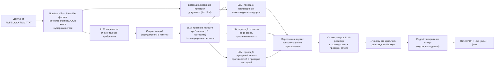

# req-review-agent — ИИ-агент статической проверки требований

**Команда:** Mog department · **Кейс:** [BCC-HUB x MNU FinTech Hackathon — агент проверки требований](https://github.com/BCC-HUB/ai-requirements-validator-task)

Агент читает документ требований (PDF, DOCX, Markdown, TXT; сканы — через OCR), выделяет отдельные
требования, проверяет **каждое требование** и **набор целиком** по **ISO/IEC/IEEE 29148:2018 (п. 5.2.5, 5.2.6)**
и **IEEE Std 830-1998 (п. 4.3)** и выпускает отчёт на русском языке (PDF, Markdown, JSON) по шаблону
организаторов. Каждое нарушение привязано к строке документа и подтверждено дословной цитатой.

| | |
|---|---|
| Модель | Google Gemini `gemini-3.8-flash` (бесплатный тариф Google AI Studio); резервные — `gemini-3.6-flash`, `gemini-3.5-flash-lite`, `gemini-3.1-flash-lite`. Поддерживаются также OpenAI-совместимые API и локальная Ollama |
| Среда | Python ≥ 3.10; зависимости — `requirements.txt` (OCR — опционально, `requirements-ocr.txt`) |
| Запуск | одна команда: `python review.py <файл требований> <файл отчёта>` |
| Время прогона | 5–10 минут на документ ~5 страниц (бесплатный тариф) |

---

## Быстрый старт

```bash
git clone https://github.com/gooflamingo75/req-review-agent.git && cd req-review-agent
python -m pip install -r requirements.txt
cp .env.example .env            # вписать ключ: GEMINI_API_KEY=<ключ из https://aistudio.google.com/apikey>
python review.py docs/requirements.md reports/report.pdf
```

- **Ключ LLM:** создаётся в [Google AI Studio](https://aistudio.google.com/apikey) (бесплатно) и указывается в
  `.env` в переменной `GEMINI_API_KEY`. Файл `.env` исключён из репозитория (`.gitignore`); в корне лежит шаблон
  `.env.example` без ключа.
- **Вход:** путь к документу требований (документ организаторов в репозиторий не входит — положите его,
  например, в `docs/requirements.md`). Форматы: PDF, DOCX, MD, TXT.
- **Выход:** рядом с указанным путём создаются `report.pdf` (основной отчёт), `report.md` (тот же отчёт в
  Markdown) и `report.json` (данные прогона: дефекты, решения, план, статистика, покрытие). Расширение в
  команде (`.pdf` или `.md`) на состав файлов не влияет.

Дополнительные режимы:

```bash
python review.py examples/sample_requirements.md reports/demo.pdf --mock      # проверка установки без ключа (только правила)
python review.py docs/requirements.md reports/report.pdf --from-json reports/report.json   # перестроить отчёт без вызова модели
python review.py docs/requirements_v2.md reports/v2.pdf --compare reports/report.json      # «было → стало» после правок документа
python review.py docs/requirements.md reports/report.pdf --primary-only       # только основная модель, без резервных
python -m pip install pytest && python -m pytest -q                            # автотесты (без ключа)
```

**Статус проверки** (на обложке и в разделе 1.1 отчёта):

| Статус | Значение |
|---|---|
| Завершена | документ прочитан полностью, все этапы проверки выполнены |
| Частичная | часть документа не прочитана или не проверена (перечислено в разделе 1.1); вердикт относится только к проверенной части |
| Не выполнена | документ пустой, повреждён, защищён паролем или модель недоступна — создаётся диагностический отчёт с причиной |
| Нет оцениваемых требований | файл прочитан, требований в нём нет |

Ссылки «строка N» в PDF кликабельны и ведут в приложение «Исходный текст» (весь документ с номерами строк).

---

## Сканы и OCR (необязательно)

Обычные PDF, DOCX, MD и TXT читаются без OCR. OCR нужен, только если документ — **скан** или требования есть
на **картинках**. Агент сам проверяет каждую страницу: если на ней нет текстового слоя, текст искажён или
страница — изображение, он вызывает OCR. Если OCR не установлен, агент **не делает вид, что всё прочитал**:
страница помечается как непрочитанная, статус проверки становится «Частичная», а в разделе 1.1 написано, что сделать.

Установка (один раз):

- **macOS:** `brew install tesseract tesseract-lang`, затем `python3 -m pip install -r requirements-ocr.txt`
- **Windows:** установите Tesseract (сборка UB Mannheim: https://github.com/UB-Mannheim/tesseract/wiki), в
  установщике отметьте язык **Russian**; затем `python -m pip install -r requirements-ocr.txt`. Если программа
  не находится, впишите в `.env` путь: `TESSERACT_CMD=C:\Program Files\Tesseract-OCR\tesseract.exe`

Проверка установки: `python ocr_worker.py --check` — должно появиться `"ok": true`. Проверка распознаёт
контрольную картинку с русским текстом и цифрами, а не только смотрит, что программа есть.

Что сознательно не сделано: агент **не устанавливает** OCR сам во время проверки (установка системных программ
по ходу работы небезопасна и непредсказуема) и не отправляет документы во внешние OCR-сервисы. Docker-образ и
lock-файл с хешами пакетов не поставляются: версии, на которых проверена работа, указаны в `requirements-ocr.txt`.

Что OCR умеет и не умеет: он распознаёт то, что **видно** на странице. Он не восстановит вырезанные страницы,
обрезанный файл или документ под паролем. Строки, распознанные OCR, помечены в отчёте; критичный вывод, который
держится только на неуверенно распознанной строке, понижается до MAJOR с пометкой «сверьте с оригиналом».

---

## Как работает агент



1. **Приём и чтение.** Агент делает снимок файла, считает SHA-256 и размер, определяет фактический формат по
   содержимому (переименованная картинка не выдаётся за PDF), проверяет пустой файл, повреждения и пароль.
   Каждая страница PDF проверяется: есть ли текстовый слой, не искажён ли текст, не скан ли это; при
   необходимости вызывается OCR в отдельном процессе с ограничением времени. Ссылки на приложения, которых нет
   в файле, отмечаются как подозрение на неполный комплект. Всё это — инциденты `ING-…`, отдельно от дефектов.
   Затем фиксируется **канонический транскрипт**: пронумерованные строки (для PDF — страница и строка L…),
   разделы и части документа. На него ссылаются все цитаты, счётчики и приложение «Исходный текст».
2. **Нарезка.** Модель выделяет элементарные требования — в т. ч. из таблиц параметров API, кодов ответов,
   критериев приёмки и требований без слова «должен». Каждая формулировка сверяется с текстом документа;
   выдуманные отбрасываются. Требования получают ID `REQ-01…`, исходный ID документа сохраняется.
3. **Проверка каждого требования** — по 10 критериям: 6 основных из руководства организаторов (полнота,
   однозначность, непротиворечивость, тестируемость, реализуемость, необходимость) и 4 дополнительных из
   ISO/IEC/IEEE 29148 (без лишних проектных решений, атомарность, корректность, соответствие форме).
   Для каждого требования модель видит весь документ, даёт комментарий по каждому критерию, дефекты с
   цитатой, рекомендацию, **идеи тест-кейсов и граничные значения** и **вопросы к аналитику**.
   Словарь размытых формулировок («быстро», «удобно», «и т.д.», «по возможности», TBD…) дополняет модель.
4. **Проверка набора** — три отдельных прохода модели:
   - *непротиворечивость, архитектура и стандарты:* попарное сравнение правил, критерии приёмки vs правила,
     основная часть vs дочерняя спецификация API, единицы и типы данных, HTTP-методы и коды ответов (RFC 9110),
     безопасность, идемпотентность;
   - *полнота, пограничные сценарии, прослеживаемость:* пробелы и заглушки, негативные сценарии,
     **таблица непокрытых edge cases**, **матрица прослеживаемости** Бизнес-цель → UI/UX → Требование →
     API/Данные → Критерии приёмки;
   - *сценарный анализ противоречий:* модель группирует правила по объекту (лимиты, частоты, триггеры,
     исключения, сбросы), для каждой пары проигрывает конкретный сценарий с числами и датами и сравнивает
     результаты; затем проверяет каждый критерий приёмки и **собственные идеи тест-кейсов** против всех правил.
     Найденное противоречие переопределяет оценку «Непротиворечивость» у обоих требований.
5. **Детерминированные проверки документа (без LLM)** — универсальные правила, применимые к любой
   спецификации: смешение основной и дробной денежной единицы без правила конвертации; HTTP GET для операции,
   изменяющей состояние; пример ошибки в разделе успешного ответа 200; заглушки шаблона («заполняются …»,
   «—», «Да / Нет» без отметки, пустые таблицы, незаполненная версия); Content-Type при отсутствии тела;
   схема ответа и пример того же ответа с разными типами поля; одно поле хранения («DB field») с разными типами
   в запросе и ответе; имена классов реализации и схема БД в требованиях; срок без перцентиля и точки измерения.
   Их результаты передаются модели как подсказки и добавляются в отчёт, если модель их не нашла
   (помечены «автоматическая проверка»).
6. **Консолидация по первопричине.** Один дефект, найденный в нескольких местах (например, GET для операции
   сохранения в описании метода, в curl-примере и в логике), становится ОДНИМ дефектом со списком всех мест;
   дословные дубли удаляются. Счётчики и Action Items считаются по уникальным дефектам, число мест — отдельно
   («3 блокера в 11 местах»). У каждого требования указаны затрагивающие его системные дефекты.
7. **Верификация.** Каждая цитата ищется в документе (без учёта регистра, пробелов и вида кавычек; с нечётким
   поиском рядом с требованием). Замечания без подтверждения отбрасываются, всё это фиксируется в журнале отчёта.
8. **Самопроверка отчёта.** Агент проверяет сам себя, прежде чем выдать отчёт:
   - *LLM-ревьюер второго уровня* перечитывает все найденные дефекты вместе с документом и ищет ложные
     срабатывания (дефект «опровергается» текстом документа), завышенную критичность (стиль и оформление —
     не выше MINOR) и неверный критерий. Снять дефект можно только с **дословной цитатой-доказательством**
     из документа — иначе дефект остаётся. Все снятые дефекты видны в приложении «Отклонено при самопроверке»;
   - *запрет выдуманных значений:* URL, пути и значения, которых нет в документе, заменяются на
     «<указать …>» — агент не придумывает за аналитика;
   - *согласованность отчёта:* у каждого ❌/⚠️ в таблице критериев есть конкретный дефект с местом; найденное
     противоречие отражается у обоих требований; комментарий «согласовано» не может стоять у проваленного критерия;
   - *покрытие критериями приёмки:* правила, у которых нет ни одного критерия приёмки, выносятся отдельным дефектом;
   - *структура документа:* пункт, оказавшийся под заголовком чужого раздела (например, описание кода 404
     внутри раздела 403), определяется автоматически, а место указывается по фактическому разделу.

**Надёжность и скорость работы с LLM:** JSON-режим ответа и повторный запрос при невалидном JSON;
перед стартом основная модель проверяется коротким запросом; при перегрузке (503), тайм-ауте или обрыве основная
модель получает один быстрый повтор, затем запрос уходит на резервную, а основная пропускается не дольше минуты и
снова получает запросы первой (флаг `--primary-only` — ждать только основную модель); причины отказов видны в
паспорте отчёта;
отсутствующие модели (404) и модели с исчерпанным дневным лимитом исключаются до конца прогона; при
поминутном лимите (429) — пауза по `retryDelay`; тайм-аут одного запроса 4 мин. Независимые запросы
(пакеты проверки требований и два прохода проверки набора) выполняются параллельно, результаты собираются
в исходном порядке — отчёт от этого не меняется; если пакет не удалось проверить — применяются правила, а в отчёте есть предупреждение.

### Критерии

| Код | Отдельное требование | Источник |
|---|---|---|
| COM | Полнота | 29148 §5.2.5 d, IEEE 830 §4.3.3, руководство 1.1 |
| UNA | Однозначность | 29148 §5.2.5 c, IEEE 830 §4.3.2, руководство 1.2 |
| CON | Непротиворечивость | IEEE 830 §4.3.4, руководство 1.3 |
| VER | Тестируемость (проверяемость) | 29148 §5.2.5 g, IEEE 830 §4.3.6, руководство 1.4 |
| FEA | Реализуемость | 29148 §5.2.5 f, руководство 1.5 |
| NEC | Необходимость | 29148 §5.2.5 a, руководство 1.6 |
| APP | Без лишних проектных решений | 29148 §5.2.5 b, руководство 1.6 |
| SIN | Атомарность | 29148 §5.2.5 e |
| COR | Корректность | 29148 §5.2.5 h, IEEE 830 §4.3.1 |
| CNF | Соответствие форме и трассируемость | 29148 §5.2.5 i, IEEE 830 §4.3.8 |

| Код | Набор требований | Источник |
|---|---|---|
| S-COMPL | Системная полнота | 29148 §5.2.6 a, IEEE 830 §4.3.3, руководство 2.1 |
| S-CONS | Взаимная непротиворечивость | 29148 §5.2.6 b, IEEE 830 §4.3.4, руководство 2.2 |
| S-FEAS | Архитектурная осуществимость и стандарты | 29148 §5.2.6 c |
| S-COMP | Понятность | 29148 §5.2.6 d |
| S-BND | Ограниченность | 29148 §5.2.6 e |
| S-RANK | Ранжированность | IEEE 830 §4.3.5 |
| S-MOD | Модифицируемость и версионность | IEEE 830 §4.3.7 |
| S-TRC | Прослеживаемость | IEEE 830 §4.3.8, руководство 2.3 |

**Критичность** (по руководству организаторов): 🔴 **CRITICAL** — прямые противоречия, непроверяемость,
грубые нарушения стандартов протоколов, отсутствие обработки критических ошибок (разработку начинать нельзя);
🟡 **MAJOR** — неполнота сценариев, двусмысленность, расхождения форматов и типов, пустые разделы;
🟢 **MINOR** — стиль, версионирование, незаполненный блок согласующих.

### Состав отчёта (по шаблону организаторов)

Первая страница — обложка для руководителя, дальше — **разделы 1–6 строго в порядке шаблона организаторов**,
затем приложения. Оформление — в фирменном зелёном BCC (#00ab75).

- **Обложка — вердикт и решения.** Вердикт одной фразой и ключевые цифры; ценность в цифрах (время проверки
  агентом против оценки ручной инспекции: ≈1 стр. в час по Gilb & Graham, «Software Inspection»); при `--compare` —
  «было → стало». Затем **решения до старта разработки**: у каждого — вопрос, варианты (значения берутся из
  документа), одна строка влияния на бизнес и кто решает.
1. **Паспорт прогона** и объём проверки (модель, SHA-256, статус, сколько текста проверено; если основная модель
   не ответила — почему, по ответам сервиса).
2. **Нарезка и инвентаризация требований.**
3. **Детальная проверка каждого требования** (матрица ✅/⚠️/❌ по 10 критериям, карточки дефектов с цитатой, местом,
   рекомендацией и «Почему это критично»).
4. **Проверка набора требований в целом** (полнота, непротиворечивость, осуществимость, прослеживаемость,
   пограничные сценарии).
5. **Сводная статистика.**
6. **Итоговый вердикт и первоочередные рекомендации:** вердикт, решения, план исправлений по ролям (аналитик /
   владелец API / QA), вопросы к аналитику, тест-кейсы.
- **Приложения:** А — полная матрица критериев и прослеживаемость; Б — критерии и методика; при `--compare` —
  «Что изменилось»; В — журнал проверки и отклонённые ложные срабатывания; Г — приём документа и покрытие;
  Д — **исходный текст** с номерами строк (цель всех ссылок в PDF).

### Точность отчёта

- **Один дефект — одна первопричина.** Если одна проблема нарушает сразу несколько критериев (например,
  «срок не задан» — это и неполнота, и неоднозначность, и непроверяемость), в отчёте один дефект со списком
  критериев, а не три. Одна проблема, найденная и как системный дефект набора, и как дефекты отдельных
  требований, тоже сводится в один дефект со всеми местами. Противоречия между разными парами требований не
  склеиваются.
- **Классификация.** Каждое замечание — либо дефект, либо вопрос (уходит в вопросы к аналитику), либо
  необязательная рекомендация (отдельная таблица «не дефекты»). В счётчики дефектов попадают только дефекты.
- **Проверка доказательств.** Модель-критик может отклонить, переклассифицировать или **разделить** составное
  замечание: подтверждённая часть остаётся, неподтверждённая уходит в журнал отклонённых. Противоречие
  засчитывается, только если правила дают разный результат в одном и том же случае (запрос и ответ с разными
  типами полей — не противоречие; схема ответа и пример того же ответа — противоречие).
- **Решения остаются открытыми.** Бизнес-решение не принимается за владельца продукта: рекомендации нейтральны,
  действия плана, которые зависят от решения, помечены «После решения D-xx» и не закрывают дефект полностью,
  а тест-кейсы с ожидаемым результатом, зависящим от решения, помечены «условный».
- **Шкала критичности.** Незаполненный раздел или оформление — не выше MAJOR, если отдельный блокирующий
  эффект не установлен; формулировка цели/контекста и просьба добавить детали хранения (типы колонок БД) — не
  выше MINOR (с пояснением в карточке).
- **Ссылки на строки проверяются.** Если строка, на которую ссылается дефект, не содержит упомянутого фрагмента,
  а соседняя содержит — ссылка исправляется. Пограничный сценарий или вопрос снимается самопроверкой, только
  если ответ найден в другом месте документа, а не в самом правиле, к которому задан вопрос.
- **Целостность PDF.** Каждый фрагмент PDF сверяется с исходным текстом; если движок раскладки потерял строки
  таблицы на разрыве страницы, фрагмент перерисовывается.
- **Записи строятся кодом.** Решения (D-xx), план (A-xx, по одному действию на дефект), вопросы (Q-xx),
  тест-кейсы (TC-xx) и вся статистика строятся из итогового реестра дефектов (`reqreview/records.py`), поэтому
  все страницы ссылаются на одни и те же ID.
- **Проверка перед выводом (V01–V10):** уникальные ID, ссылки без «висячих» номеров, цитаты совпадают с
  документом, счётчики сходятся, у каждого дефекта есть путь исправления, условные тесты помечены и т. д.
  При ошибке — ограниченный автоматический ремонт; если не помогло, статус проверки становится «частичная», а на
  первой странице появляется предупреждение. Смысловая проверка выполняется той же моделью — это дополнительная
  проверка, а не независимая валидация.
- **Регрессионные сценарии** R01–R20 — в `tests/test_regressions.py` (детерминированная часть). R06, R11, R15,
  R16 зависят от суждения модели: они закреплены в промптах и проверке критика, но без модели не тестируются.

**Цикл «исправили → перепроверили»:** после правок документа запустите агента с `--compare` и прошлым
`.json` — на первой странице появится «было → стало», в приложении — какие дефекты закрыты, какие новые:

```bash
python review.py docs/requirements_v2.md reports/v2.pdf --compare reports/v1.json
```

Рядом с отчётом сохраняется `report.json` — те же данные в машиночитаемом виде (для CI, трекеров задач,
дашбордов), включая статус проверки, журнал приёма документа и манифест покрытия.

**Код завершения команды** (для автоматизации): `0` — проверка завершена; `10` — частичная (отчёт есть,
ограничения в разделе 1.1); `11` — нет оцениваемых требований; `2` — документ нельзя прочитать (диагностический
отчёт); `3` — модель недоступна (диагностический отчёт); `4` — PDF не создан (Markdown и JSON есть).

### Соответствие требованиям кейса

| Требование кейса | Где выполнено |
|---|---|
| Чтение PDF + других форматов | `reqreview/loader.py`, `reqreview/ingest.py` (PDF, DOCX, Markdown, TXT; сканы — OCR) |
| Отчёт-файл | PDF (основной) + Markdown + JSON, одна модель данных |
| Выделение отдельных требований, свои ID при отсутствии, цитата | шаг 2, раздел 2 отчёта («ID в отчёте — ID в документе — формулировка и цитата») |
| Проверка каждого требования и набора по ISO 29148 / IEEE 830 | шаги 3–4, разделы 3–4 отчёта |
| Каждое нарушение ссылается на конкретное место | строка/страница + раздел + дословная цитата, верификация |
| Паспорт (документ, дата, модель, версия агента и коммит), нарезка, сводка, итог | разделы 1, 2, 5, 6 отчёта; итог также на обложке |
| Отчёт сформирован агентом, а не вручную | паспорт: модель, SHA-256 документа, версия и коммит агента; `report.json` с исходными данными прогона |
| Запуск одной командой: путь к требованиям и путь к отчёту | `python review.py <файл> <отчёт>` (или `--input/--output`) |
| README, зависимости, `.env.example` без ключа | этот файл, `requirements.txt`, `.env.example` |

## Настройки (`.env`)

| Переменная | По умолчанию | Назначение |
|---|---|---|
| `LLM_PROVIDER` | `gemini` | `gemini`, `openai` (любой OpenAI-совместимый API) или `ollama` |
| `GEMINI_API_KEY` | — | ключ Google AI Studio |
| `GEMINI_MODEL` | `gemini-3.8-flash` | модель Gemini |
| `GEMINI_FALLBACK_MODELS` | `gemini-3.6-flash,…` | резервные модели: при перегрузке (503) основная модель получает один быстрый повтор, затем запрос уходит на резервную, а основная пропускается не дольше 1 мин; 404 и дневной лимит — модель исключается. Перед стартом основная модель проверяется коротким запросом, причины отказов попадают в паспорт отчёта |
| `GEMINI_PRIMARY_ONLY` | — | `1` — только основная модель: при перегрузке ждать её, а не переходить на резервные (то же, что флаг `--primary-only`) |
| `REQUEST_INTERVAL_SEC` | `6` | пауза между запросами к одной модели (лимиты бесплатного тарифа) |
| `PARALLEL_REQUESTS` | `4` | сколько независимых запросов выполнять одновременно (1 — по очереди) |
| `BATCH_SIZE` | `8` | требований в одном запросе на проверку |
| `MAX_INPUT_MB` / `MAX_PAGES` | `50` / `200` | лимиты; превышение честно показывается как непроверенная часть |
| `OCR_ENABLED` | `auto` | `auto` — использовать OCR, если установлен; `off` — не использовать |
| `OCR_LANGUAGES` / `OCR_DPI` / `OCR_PAGE_TIMEOUT_SEC` | `rus+eng` / `300` / `60` | параметры OCR |
| `TESSERACT_CMD` | — | путь к программе Tesseract, если она не находится автоматически |
| `PDF_PASSWORD` | — | пароль защищённого PDF (только если он вам законно передан; обход пароля не выполняется) |

Параметры командной строки: `--input/-i`, `--output/-o` (альтернатива позиционным аргументам), `--model <имя>`,
`--batch-size <N>`, `--mock` (демо без модели), `--from-json <report.json>` (перестроить отчёт без модели),
`--compare <прошлый.json>` (блок «что изменилось»), `--primary-only` (только основная модель).

## Диагностика

| Сообщение | Причина и действие |
|---|---|
| `Не задан GEMINI_API_KEY` | Файл `.env` должен лежать в корне репозитория (не `.env.txt`). |
| `Ключ отклонён` | Скопируйте ключ заново из AI Studio, без пробелов и кавычек. |
| `Модель … не найдена` | Укажите в `.env` другую модель из списка в AI Studio (https://aistudio.google.com). |
| Ошибка 503 (перегрузка) | Агент сам повторяет запрос и переключается на резервную модель; фактически использованные модели и причины отказов — в паспорте отчёта. Чтобы использовать только основную модель: `--primary-only`. |
| Ошибка 429 / лимит | Агент сам ждёт и повторяет. Если исчерпан дневной лимит — попробуйте позже или другую модель. |
| Статус «Частичная» | Откройте раздел 1.1 отчёта: там написано, что не прочитано или не проверено и что сделать. |
| «OCR недоступен» | Документ — скан или в нём картинки. Установите OCR (раздел «Сканы и OCR») или используйте PDF с текстовым слоем. |
| «PDF не создан» | Markdown и JSON создаются независимо от PDF; причина — в выводе консоли и в `report.json` (`outputs.pdf_error`). |

## Структура репозитория

```
review.py               — точка входа (одна команда)
reqreview/ingest.py     — приём файла: снимок, SHA-256, формат, пустые/повреждённые/зашифрованные, инциденты ING-…
reqreview/loader.py     — чтение PDF/DOCX/MD/TXT, контроль качества страниц, OCR-восстановление, транскрипт, поиск цитат
reqreview/ocr.py        — вызов OCR в отдельном процессе с ограничением времени
ocr_worker.py           — OCR-воркер (Tesseract) и проверка установки: python ocr_worker.py --check
reqreview/coverage.py   — учёт покрытия (символы, фрагменты, обязательные проверки) и статус проверки
reqreview/llm.py        — Gemini / OpenAI-совместимый API / демо-режим, повторы при лимитах
reqreview/prompts.py    — промпты
reqreview/criteria.py   — критерии ISO/IEC/IEEE 29148, IEEE 830 и руководства организаторов; классификация критичности
reqreview/rules.py      — правила без LLM (размытые слова, TBD, технологии, ID, единицы, HTTP, заглушки)
reqreview/agent.py      — конвейер: выделение → проверка требований → проверка набора (3 прохода) → верификация
reqreview/verify.py     — самопроверка: LLM-ревьюер второго уровня, удаление выдуманных URL, согласованность отчёта
reqreview/consolidate.py — объединение дефектов с общей первопричиной, удаление дублей
reqreview/records.py    — решения, план, вопросы, тест-кейсы и статистика из реестра дефектов; проверки V01–V10
reqreview/present.py    — страницы отчёта (решения, план по ролям, вопросы и тесты, приложения)
reqreview/compare.py    — сравнение двух прогонов (--compare): закрыто / новое / осталось
reqreview/report.py     — запись отчёта: данные прогона → report.json, Markdown и PDF
reqreview/pdf.py        — PDF-версия отчёта: шрифты с кириллицей, ссылки на строки, закладки, номера страниц
reqreview/util.py       — общие функции (нормализация текста, ячейки таблиц)
examples/               — учебный документ с намеренными дефектами (не документ организаторов)
tests/                  — автотесты без ключа (test_pipeline.py, test_ingest.py, test_regressions.py)
requirements-ocr.txt    — необязательные пакеты для OCR
```

## Команда

**Mog department** — решение кейса «Агент проверки требований», BCC-HUB x MNU FinTech Hackathon.
